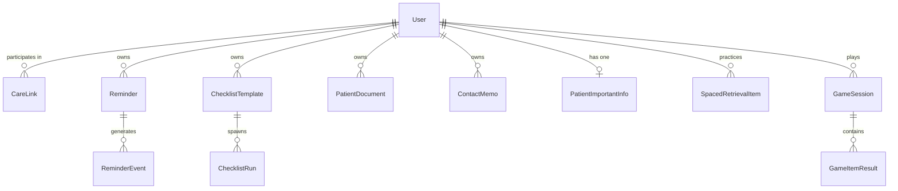
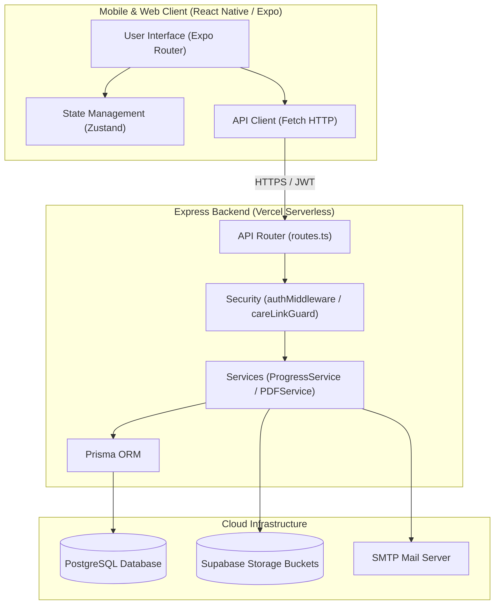
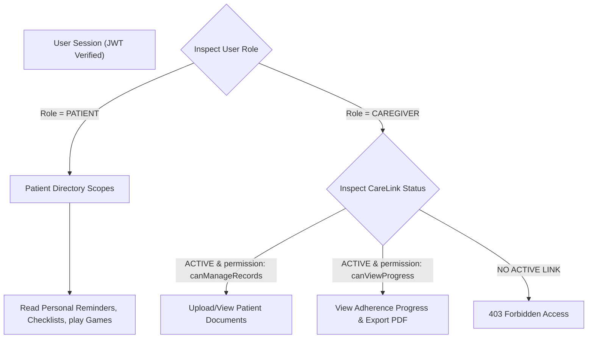
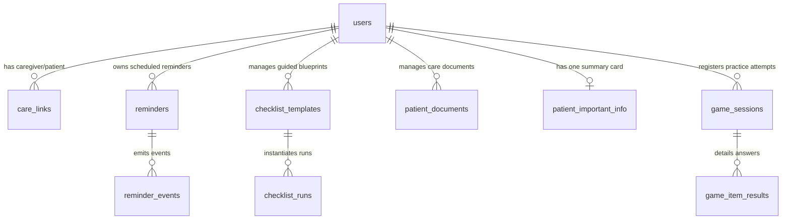
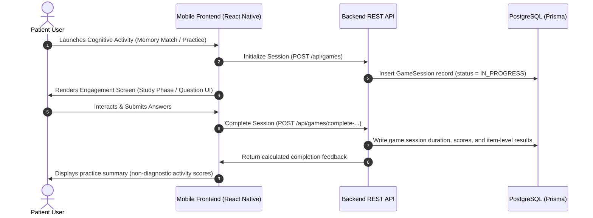
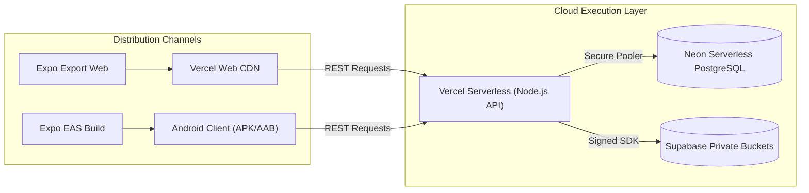

# Thesis System Design and Architecture Report
**Project Name:** Cognitive and Memory Support Application for People with Early-Stage Alzheimer’s Disease
**App Name:** MemoCare (Arabic: رفيق الذاكرة - Rafiq Al-Dhakira)

============================================================
## 1. Executive Architecture Summary
============================================================
The MemoCare system is structured as a modern full-stack web and mobile application, designed as a support tool for patients with early-stage Alzheimer's disease and a management interface for their caregivers. 

- **Frontend Technology**: The client application is built with React Native and Expo (SDK 54), utilizing TypeScript. State management is handled via Zustand, and navigation is powered by Expo Router.
- **Frontend Build Support**: The frontend codebase supports both Android (via EAS) and Web platforms from the same source code.
- **Backend Technology**: The backend is a Node.js REST API built with Express and TypeScript.
- **Database Technology**: The system uses a centralized PostgreSQL database acting as the single source of truth, interacted with via the Prisma ORM.
- **Storage Technology**: File and media storage (e.g., Patient Documents, Memory Aids) is handled via Supabase Storage.
- **Deployment Approach**: The backend is designed for serverless deployment on Vercel.
- **Role Model**: The system implements a strict Role-Based Access Control (RBAC) model with primary roles for `PATIENT` and `CAREGIVER`. Caregivers manage content (e.g., adding reminders, configuring memory aids) while patients consume content and log daily app activity/progress history.
- **Implemented Modules**: Authentication, Caregiver-Patient Linking, Reminders, Checklists, Contacts & Memory Aids, Patient Records (Documents), Important Information Card, Cognitive Engagement Games (Memory Match, Spaced Retrieval), Progress Tracking, and Summary PDF Export.
- **System Architecture**: The system utilizes a RESTful API architecture.

*Note: The application is a supportive management and engagement tool. It does not provide medical diagnosis, clinical assessment, or disease progression measurement.*

============================================================
## 2. Architecture Evidence Table
============================================================

| Area | Confirmed Finding | Evidence in Code | Notes / Uncertainty |
| :--- | :--- | :--- | :--- |
| **Frontend framework** | React Native + Expo | `mobile/package.json` (`expo`, `react-native`, `typescript`) | |
| **Navigation system** | Expo Router | `mobile/package.json` (`expo-router`), `mobile/app/_layout.tsx` | |
| **Patient screens** | Dedicated patient route group | `mobile/app/(patient)/home.tsx` | |
| **Caregiver screens** | Dedicated caregiver route group | `mobile/app/(caregiver)/home.tsx` | |
| **Auth storage** | Expo SecureStore (Native) / LocalStorage (Web) | `mobile/src/infrastructure/storage/secureStore.ts` | |
| **API client/base URL** | Configured via environment variable | `mobile/src/infrastructure/api/client.ts` (`EXPO_PUBLIC_API_URL`) | |
| **Backend framework** | Node.js + Express | `backend/package.json` (`express`), `backend/src/app/app.ts` | |
| **API style** | REST API | `backend/src/app/routes.ts` (e.g., `app.use('/api/patients', ...)`), `backend/src/app/app.ts` (`express.json()`) | |
| **Authentication method** | JWT Bearer Token | `backend/src/shared/middleware/auth.middleware.ts` (`jwt.verify`) | |
| **Authorization checks** | CareLink Guard for Caregivers | `backend/src/shared/middleware/careLinkGuard.middleware.ts` | Validates patient-specific access and permissions |
| **Prisma usage** | Prisma ORM | `backend/src/app/server.ts` (`connectDatabase()`) | |
| **Database provider** | PostgreSQL | `backend/prisma/schema.prisma` (`provider = "postgresql"`) | |
| **Supabase usage** | External Storage Provider | `backend/package.json` (`@supabase/supabase-js`), `schema.prisma` (`PatientDocument.storageProvider @default("supabase")`) | |
| **File storage** | MediaAsset & PatientDocument models | `backend/prisma/schema.prisma` (`MediaAsset`, `PatientDocument`) | |
| **Patient records** | Implemented as Documents | `mobile/app/(caregiver)/records`, `schema.prisma` (`PatientDocument`) | |
| **Important info card** | Implemented | `mobile/app/(patient)/important-info.tsx`, `schema.prisma` (`PatientImportantInfo`) | |
| **Summary PDF export** | Implemented (PDFKit + Arabic Support) | `backend/src/modules/summary-exports/router.ts`, `mobile/app/(caregiver)/export-summary.tsx` | |
| **Memory Match** | Implemented | `mobile/app/(patient)/memory-match-game.tsx` | |
| **My Day & People** | Implemented (Spaced Retrieval / Orientation) | `mobile/app/(patient)/orientation-practice.tsx`, `schema.prisma` (`SpacedRetrievalItem`) | |
| **Game sessions/results** | Tracked in Database | `schema.prisma` (`GameSession`, `GameItemResult`, `GameLevelResult`) | |
| **Progress tracking** | Implemented | `mobile/app/(patient)/progress.tsx`, `backend/src/modules/progress/router.ts` | |
| **Localization/i18n** | i18next | `mobile/package.json` (`i18next`, `react-i18next`) | |
| **Arabic support** | Implemented | `schema.prisma` (`language String @default("ar")`), `bidi-js` & `naqqash` (PDF generation) | |
| **Android build support** | Supported | `mobile/package.json` (`"android": "expo start --android"`) | |
| **Web build support** | Supported | `mobile/package.json` (`"web": "expo start --web"`) | |
| **Vercel deploy config** | Serverless function config | `backend/vercel.json` | Uses `@vercel/node` builder |

============================================================
## 3. Frontend Architecture
============================================================

**3.1 Is the frontend Expo/React Native/TypeScript?**
Yes. The frontend uses Expo (SDK 54), React Native (0.81.5), and TypeScript (`mobile/package.json`).

**3.2 Does it support both Android and web?**
Yes. The codebase contains build scripts for both Android (`"android": "expo start --android"`) and Web (`"web": "expo start --web"`, `"build:web": "expo export --platform web"`).

**3.3 Does it use Expo Router? If yes, describe the route structure.**
Yes. It uses `expo-router` (~6.0.23). The routing structure is divided into organizational groups:
- `(auth)`: Login and registration flow.
- `(patient)`: Patient-specific interfaces and games.
- `(caregiver)`: Caregiver management dashboards and settings.

**3.4 How are patient screens separated from caregiver screens?**
They are separated using Expo Router's group routing feature (`mobile/app/(patient)` and `mobile/app/(caregiver)` directories).

**3.5 Where are shared components stored?**
Shared components and features are stored outside the routing directory, primarily in the `mobile/src` directory (e.g., `mobile/src/features/auth`, `mobile/src/infrastructure`).

**3.6 Where is the API client implemented?**
The API client is a custom wrapper over the native `fetch` API, implemented in `mobile/src/infrastructure/api/client.ts`. It automatically attaches JWT Bearer tokens to requests.

**3.7 How is the backend base URL configured?**
The backend base URL is securely configured using the environment variable `EXPO_PUBLIC_API_URL` within `mobile/src/infrastructure/api/client.ts`.

**3.8 How is authentication state stored on native and web?**
Authentication state (JWT token) is securely stored depending on the platform. It uses `expo-secure-store` for native iOS/Android devices and `localStorage` as a fallback for the Web platform (`mobile/src/infrastructure/storage/secureStore.ts`).

**3.9 Is there any local SQLite/offline-first persistence used for real app data?**
While `expo-sqlite` exists in the `package.json` dependencies, the core application relies heavily on the backend REST API as the single source of truth for real app data. Complex offline-first synchronization using SQLite is not the primary architecture pattern.

**3.10 What frontend modules/screens are implemented?**
Implemented modules include: Auth/Login, Patient/Caregiver Home, Reminders, Checklists, Contacts, Patient Records, Important Information, Memory Match, Orientation Practice, Progress Tracking, and Summary PDF Export.

| Frontend Module | Purpose | Main Files | Patient/Caregiver/Shared |
| :--- | :--- | :--- | :--- |
| **Auth/Login** | User registration and login | `mobile/app/(auth)/*`, `mobile/src/features/auth/*` | Shared |
| **Patient Home** | Today view and daily support | `mobile/app/(patient)/home.tsx` | Patient |
| **Caregiver Home** | Dashboard and patient overview | `mobile/app/(caregiver)/home.tsx` | Caregiver |
| **Reminders** | Task and medication alerts | `(patient)/my-reminders.tsx`, `(caregiver)/manage-reminders.tsx` | Shared |
| **Checklists** | Step-by-step guided routines | `(patient)/checklist.tsx`, `(caregiver)/manage-checklists.tsx` | Shared |
| **Contacts/Memory Aids** | Spaced retrieval configuration | `(patient)/contacts/*`, `(caregiver)/contacts.tsx`, `manage-sr-items.tsx` | Shared |
| **Patient Records** | Medical/document record storage | `(caregiver)/records/*` | Caregiver |
| **Important Information** | Critical care summaries | `(patient)/important-info.tsx`, `(caregiver)/important-info.tsx` | Shared |
| **Memory Match** | Cognitive engagement game | `(patient)/memory-match-game.tsx` | Patient |
| **My Day & People** | Spaced retrieval orientation game | `(patient)/orientation-practice.tsx` | Patient |
| **Progress Tracking** | Analytics and activity history | `(patient)/progress.tsx`, `(caregiver)/progress.tsx` | Shared |
| **Summary PDF Export** | PDF report generation | `(caregiver)/export-summary.tsx` | Caregiver |

============================================================
## 4. Backend Architecture
============================================================

**4.1 Is the backend Node.js/Express/TypeScript?**
Yes. The backend utilizes Node.js, Express (v5.2.1), and is fully typed with TypeScript (`backend/package.json`).

**4.2 Is it deployed as a Vercel serverless API or another style?**
It is configured for Vercel serverless deployment.

**4.3 What is the backend entrypoint for Vercel?**
The Vercel entrypoint is `api/index.ts` as defined in `backend/vercel.json`.

**4.4 Is the backend REST API or GraphQL?**
The backend is a REST API.

**4.5 How are routes organized?**
Routes are grouped by feature domains within the `backend/src/modules/` directory (e.g., `auth`, `reminders`, `games`). These are centrally registered in `backend/src/app/routes.ts`.

**4.6 Are there controllers/services/middleware, or mostly route handlers?**
The architecture follows a structured pattern with dedicated controllers, services, and middlewares (e.g., `notifications.controller.js`, `pdf.service.ts`).

**4.7 Where is authentication middleware implemented?**
Authentication middleware is implemented in `backend/src/shared/middleware/auth.middleware.ts`, which verifies the JWT Bearer token.

**4.8 Where is authorization / patient-scoping implemented?**
Patient-scoping and authorization are enforced via the `careLinkGuard` middleware (`backend/src/shared/middleware/careLinkGuard.middleware.ts`). It verifies if a Caregiver has an active `CareLink` to the requested Patient and checks for specific module permissions (e.g., `canViewProgress`).

**4.9 Where is Prisma initialized?**
Prisma is initialized globally in `backend/src/shared/db/prisma.js` (or `.ts`) and imported across the application.

**4.10 What major backend modules/routes exist?**
Major modules include Auth, Users, CareLinks, Reminders, Checklists, Contacts, Media, Records, Games, Spaced Retrieval, Important Info, Progress, and Summary Exports.

| Backend Area | Route/File | Responsibility | Uses Prisma? | Protected? |
| :--- | :--- | :--- | :--- | :--- |
| **Auth** | `/api/auth` | Login, Registration, JWT issuing | Yes | No |
| **Users/Profile** | `/api/users` | User profile updates | Yes | Yes |
| **Care Links** | `/api/carelinks` | Caregiver-patient connections | Yes | Yes |
| **Reminders** | `/api/patients/:id/reminders` | Fetching/managing reminders | Yes | Yes |
| **Checklists** | `/api/patients/:id/checklists` | Checklists and active runs | Yes | Yes |
| **Contacts** | `/api/patients/:id/contacts` | Managing patient contacts | Yes | Yes |
| **Patient Records** | `/api/patients/:id/documents` | Managing medical documents | Yes | Yes |
| **Important Information** | `/api/patients/:id/important-info` | Medical info/care summaries | Yes | Yes |
| **Games** | `/api/games` | Submitting game session results | Yes | Yes |
| **Spaced Retrieval** | `/api/patients/:id/spaced-retrieval` | Fetching orientation questions | Yes | Yes |
| **Progress** | `/api/patients/:id/progress` | App activity history/analytics | Yes | Yes |
| **Summary PDF** | `/api/patients/:id/summary-exports` | PDF report generation | Yes | Yes |
| **Health** | `/api/health/db` | Database connection test | Yes | No |

============================================================
## 5. Database Architecture
============================================================

**5.1 What database provider is used?**
PostgreSQL (`provider = "postgresql"`).

**5.2 Is the schema managed through Prisma?**
Yes. The schema is entirely managed and migrated via Prisma (`backend/prisma/schema.prisma`).

**5.3 What are the main models?**
`User`, `CareLink`, `Reminder`, `ReminderEvent`, `ChecklistTemplate`, `ChecklistRun`, `GameSession`, `PatientDocument`, `ContactMemo`, `SpacedRetrievalItem`, `PatientImportantInfo`, and `MediaAsset`.

**5.4 How are users represented?**
Users are represented by the `User` model, which uses a `UserRole` enum (`PATIENT`, `CAREGIVER`, `ADMIN`) to differentiate responsibilities.

**5.5 How are patient and caregiver profiles represented?**
They are unified under the central `User` model. There are no separate tables for Patient Profile and Caregiver Profile; role-specific data is linked via relations to the `User` ID.

**5.6 How is caregiver-patient linking represented?**
Linking is represented by the `CareLink` model, which holds `caregiverUserId` and `patientUserId` with an approval `status` and specific boolean `permissions` stored as JSON.

**5.7 How are reminders represented?**
Reminders use the `Reminder` model (defining schedules, frequency, priority) and the `ReminderEvent` model (logging discrete actions like FIRED, COMPLETED, SNOOZED).

**5.8 How are checklists represented?**
Checklists utilize two models: `ChecklistTemplate` for the overarching structure/steps, and `ChecklistRun` to track an active or completed attempt of a template by a patient.

**5.9 How are contacts/memory aids represented?**
Represented through `PatientContact` (base contact info) and `ContactMemo` (detailed memory support info, photos, and priority ranks).

**5.10 How are patient records represented?**
Represented by the `PatientDocument` model, which stores metadata, categories (e.g., PRESCRIPTION, LAB_RESULT), and links to external Supabase storage buckets.

**5.11 How is the Important Information Card represented?**
Represented by the `PatientImportantInfo` model. It contains strings for living situations, allergies, routines, calming strategies, and emergency contacts.

**5.12 How are game sessions/results represented?**
Games are tracked through `GameSession` (overall attempt), `GameLevelResult` (level-by-level metrics like difficulty and solve time), and `GameItemResult` (question-by-question metrics).

**5.13 How is progress represented?**
Progress is aggregated via `AnalyticsEvent` (general app interaction) alongside the historical data in `GameSession` and `ChecklistRun`.

**5.14 How is Summary PDF export represented, if stored?**
It is represented by the `PatientSummaryExport` model, which links to generated PDF records.

**5.15 Are Memory Match and My Day & People stored using generic game models, separate models, or a mixed design?**
It is a mixed design. General game tracking (duration, level, score) uses the generic `GameSession` and `GameItemResult` models. The specific content configuration for "My Day & People" is stored in dedicated models (`SpacedRetrievalItem` and `PersonalOrientationSettings`).

### Simplified Thesis ERD Table

| Entity | Main Purpose | Main Relationships | Thesis Notes |
| :--- | :--- | :--- | :--- |
| **User** | Central identity | Has many `CareLink`, `Reminder`, `GameSession`, `PatientDocument` | Roles: PATIENT, CAREGIVER |
| **CareLink** | Authorizes caregiver access to patient | Links two `User` entities | Holds module permissions |
| **Reminder** | Scheduled task or medication alert | Belongs to `User` (Patient) | Triggers `ReminderEvent`s |
| **ChecklistTemplate** | Guided routine blueprint | Belongs to `User` (Patient) | Instantiated as `ChecklistRun` |
| **PatientDocument** | Caregiver-uploaded record | Belongs to `User` (Patient) | |
| **ContactMemo** | Memory aid for recognized people | Belongs to `User` (Patient) | Feeds data into games |
| **PatientImportantInfo** | Emergency & routine overview | Belongs to `User` (Patient) | 1-to-1 relationship |
| **SpacedRetrievalItem** | Custom orientation question | Belongs to `User` (Patient) | Drives "My Day & People" |
| **GameSession** | Activity history for cognitive games | Belongs to `User` (Patient) | Tracks engagement progress |

### Mermaid ERD Draft



============================================================
## 6. Authentication and Authorization Design
============================================================

**6.1 What authentication method is used? JWT? Sessions? Other?**
JSON Web Token (JWT) based authentication. Decoded Bearer tokens are attached to the `req.user` payload on HTTP requests.

**6.2 Where are passwords hashed?**
Passwords are encrypted in `backend/src/modules/auth/service/auth.service.ts` (lines 56–58) inside the `hashPassword` function using `bcrypt.hash(password, 12)` with `bcryptjs`.

**6.3 Where are tokens generated?**
JWT tokens are generated on successful login/sign-up in `backend/src/modules/auth/service/auth.service.ts` (lines 135–139) inside the `signJwt` helper function via the `jwt.sign(payload, env.JWT_SECRET)` method.

**6.4 Where are tokens verified?**
Tokens are validated in `backend/src/shared/middleware/auth.middleware.ts` (lines 26–42) inside the `authMiddleware` function using `jwt.verify(token, env.JWT_SECRET)`.

**6.5 What roles exist?**
Three roles are implemented: `PATIENT`, `CAREGIVER`, and `ADMIN`. 

**6.6 Are roles stored in the database?**
Yes. They are stored as the `UserRole` enum in the `User` model (`backend/prisma/schema.prisma` lines 96–100, 156).

**6.7 Are backend routes protected by middleware?**
Yes. Routes are protected by `authMiddleware` for identity validation, and then `careLinkGuard` or `roleGuard` for permission gating.

**6.8 Is authorization enforced on the backend or only frontend?**
Enforced strictly on both layers. The backend validates user scope on every request via middlewares, while the frontend hides buttons and blocks access to route directories (`(patient)` and `(caregiver)`) using Zustand store checks.

**6.9 How does the backend check whether a caregiver can access a patient?**
Through the `careLinkGuard` middleware (`backend/src/shared/middleware/careLinkGuard.middleware.ts` lines 39–85). It extracts the target patient ID from `req.params.patientId ?? req.params.id` and queries the database for an active `CareLink` record matching the requesting caregiver's ID (`req.user.userId`).

**6.10 Can a patient access only their own data?**
Yes. In the `careLinkGuard` (lines 33–37), a check bypasses the block only if the requesting user's ID matches the target patient ID (`req.user.userId === patientId`), meaning patients own their data. If the patient requests another ID, they lack a `CareLink` (since only caregivers can be linked as the caregiver role in CareLinks), resulting in access rejection.

**6.11 Can a caregiver access patient data only through a valid CareLink?**
Yes. The `careLinkGuard` strictly requires a `CareLink` record with the status `ACTIVE` and throws a 403 `CARELINK_PERMISSION_DENIED` error if none is found.

**6.12 Are Patient Records caregiver-only?**
Yes. The records router (`backend/src/modules/records/router.ts` lines 34–36) uses `roleGuard('caregiver')` and `careLinkGuard('canManageRecords')`, making documents completely inaccessible to patients.

**6.13 Is Summary PDF Export caregiver-only?**
Yes. The exports router (`backend/src/modules/summary-exports/router.ts` lines 12–13) uses `roleGuard('caregiver')` and `careLinkGuard('canViewProgress')`.

### Role-Based Access Control (RBAC) Verification Table

| Access Rule | Backend Evidence | Frontend Evidence | Thesis Wording |
| :--- | :--- | :--- | :--- |
| **Patient can access patient-facing data only** | `careLinkGuard.middleware.ts#L33-37` (self-access check) | `mobile/app/(patient)/home.tsx` (reads logged-in profile ID) | "Patient-centric dashboard scoped to personal assistance features" |
| **Caregiver can manage linked patient data** | `careLinkGuard.middleware.ts#L41-47` (searches active caregiver-patient link) | `mobile/src/state/caregiverPatientStore.ts` (manages active patient selection) | "Caregiver-facing management dashboard scoped to authenticated links" |
| **Patient cannot access Patient Records** | `records/router.ts#L34` (`roleGuard('caregiver')`) | Routing directory `/app/(caregiver)/records` is blocked for patients | "Caregiver-only document storage for health plan organization" |
| **Summary PDF is caregiver-facing** | `summary-exports/router.ts#L12` (`roleGuard('caregiver')`) | `(caregiver)/export-summary.tsx` | "Non-diagnostic progress tracking summaries for caregiver review" |
| **Selected patient is validated server-side** | `careLinkGuard.middleware.ts#L41` (queries database by `caregiverUserId` and `patientUserId`) | `mobile/src/infrastructure/api/client.ts` (appends patient ID to routes) | "Server-enforced caregiver-patient access control lists (ACL)" |
| **Module permissions in CareLink** | `careLinkGuard.middleware.ts#L74-81` (checks specific keys like `canCreateReminders` in CareLink JSON) | `mobile/app/(caregiver)/home.tsx` (blocks specific buttons based on permissions) | "Granular, permission-based delegation configuration within CareLink relations" |

============================================================
## 7. Caregiver-Patient Access Model
============================================================

**7.1 How are CareLinks created?**
They are created via an invite code handshake.

**7.2 Does caregiver invite patient, enter patient email/code, or is it seeded?**
The caregiver initiates the link by generating an invite code. The patient then accepts the code within the mobile app. The handshake process is handled via:
- Caregiver generates code: `carelinksService.createInvite` in `backend/src/modules/carelinks/service/carelinks.service.ts` (lines 28–35).
- Patient enters/accepts code: `carelinksService.acceptInvite` (lines 40–70) which verifies the status of the code in the database and links the patient ID.

**7.3 Can one caregiver manage multiple patients?**
Yes. A caregiver can generate multiple separate invites, creating multiple `CareLink` records with different `patientUserId` values.

**7.4 Can one patient have multiple caregivers?**
Yes. The database check in `carelinksService.acceptInvite` (lines 62–65) queries if an active link already exists *between those two specific user IDs*. It does not limit a patient from accepting invites from different caregivers, enabling collaborative family care.

**7.5 How does the frontend select the active patient?**
Using a dropdown patient switcher component.

**7.6 Is selected patient stored in frontend state?**
Yes. It is stored inside the Zustand state manager in `mobile/src/state/caregiverPatientStore.ts` under `selectedPatientId` and `selectedPatientName` and persists across tabs.

**7.7 Does the backend still validate patient access on every request?**
Yes. The frontend appends the `selectedPatientId` to API request paths, and the backend validates the active `CareLink` relationship on every endpoint call using the `careLinkGuard`.

**7.8 Which modules are scoped to selected patient?**
All patient management modules: Reminders, Checklists, Contacts, Patient Records (Documents), Important Information Card, Progress Tracking, and Summary PDF Exports.

### Caregiver-Patient Access Data Flow

```
[ Caregiver Logs In ] 
         ↓
[ Fetch Linked Patients ] ──(GET /api/carelinks)──> [ Reads Active Links from DB ]
         ↓
[ Select Active Patient ] ──(Zustand Store caches selectedPatientId)
         ↓
[ Perform Action ] ──(e.g., POST /api/patients/:selectedPatientId/reminders)
         ↓
[ Middleware Gating ] ──(careLinkGuard verifies active status & permission in DB)
         ↓
[ Database Scoped Execution ] ──(Prisma performs operation scoped strictly to Patient ID)
```
*Verification: Confirmed fully accurate. Enforced by `useCaregiverPatientStore` on frontend and `careLinkGuard` on backend.*

============================================================
## 8. File Storage, Patient Records, and Important Information
============================================================

**8.1 Is Supabase Storage used?**
Yes. Interacted with via the `@supabase/supabase-js` client SDK.

**8.2 Which buckets are used?**
Three dedicated buckets are declared:
- `patient-records` (for Caregiver uploads/Documents)
- `patient-exports` (for Generated Summary PDFs)
- `cognitive-media` (for general media assets)
*Note: Buckets are configured via the environment variables `SUPABASE_PATIENT_RECORDS_BUCKET`, `SUPABASE_PATIENT_EXPORTS_BUCKET`, and `SUPABASE_STORAGE_BUCKET`.*

**8.3 Are files private or public?**
They are strictly **private**. Buckets are initialized programmatically with `{ public: false }` (`backend/src/modules/records/service/records.service.ts` lines 13–17).

**8.4 Does backend generate signed URLs?**
Yes. To view or download a file, the backend generates a short-lived (5 minutes / 300 seconds) signed URL via `supabase.storage.from(bucket).createSignedUrl(key, 300)` (`backend/src/modules/records/service/records.service.ts` lines 130–132).

**8.5 How are uploads handled?**
The caregiver uploads a file via a multipart/form-data request. The backend uses `multer` to handle the file in memory (`multer.memoryStorage()`), validates MIME types (`application/pdf`, `image/*`), and streams the buffer to Supabase Storage before persisting file metadata in PostgreSQL.

**8.6 How are downloads/views handled?**
The client requests a signed view URL from `/api/patients/:patientId/documents/:documentId/view-url`. The backend runs authorization checks and generates a temporary signed URL, allowing the client to load the document securely in a web view.

**8.7 What metadata is stored in PostgreSQL?**
Stored in the `PatientDocument` model, which includes the `id` (UUID), `patientId`, `uploadedByUserId`, `title`, `category`, `documentDate`, `originalFileName`, `mimeType`, `fileSizeBytes`, `storageProvider` ("supabase"), `storageBucket`, `storageKey`, and `status` ("ACTIVE" or "ARCHIVED").

**8.8 Are Patient Records caregiver-only?**
Yes. Handled by `roleGuard('caregiver')` and `careLinkGuard('canManageRecords')`.

**8.9 What record types/categories exist?**
Prisma enum `PatientDocumentCategory` defines: `PRESCRIPTION`, `LAB_RESULT`, `SCAN_IMAGING`, `DOCTOR_VISIT_NOTE`, `DISCHARGE_SUMMARY`, `MEDICATION_PLAN`, `CARE_PLAN`, `ADMINISTRATIVE`, and `OTHER`.

**8.10 How is Important Information stored?**
Stored in the database in the `PatientImportantInfo` model (table `patient_important_info`), which maintains a 1-to-1 relationship with the patient `User` model.

**8.11 Is Important Information structured fields or free text?**
It is **highly structured**. The database model consists of structured, dedicated fields (e.g. `allergies`, `livingSituation`, `morningRoutineNotes`, `calmingStrategies`, `emergencyInstructions`) that allow the caregiver to input text instructions.

**8.12 Is Important Information patient-facing, caregiver-facing, or both?**
It is **both**. Caregivers have read-write access. Patients can view specific fields on their screen (`mobile/app/(patient)/important-info.tsx`) filtered by the `visibilityConfig` JSON settings.

### Document and Care Information Storage Table

| Feature | Storage Location | Access Control | Main Files/Models | Notes |
| :--- | :--- | :--- | :--- | :--- |
| **Patient Documents** | Supabase Storage Bucket (`patient-records`) + PostgreSQL metadata | Caregiver-only (`roleGuard('caregiver')` + `canManageRecords` permission check) | `records.service.ts`, Prisma model `PatientDocument` | Termed "patient documents" or "patient records". |
| **Emergency Contacts** | PostgreSQL | Caregivers (read/write), Patients (read-only) | Prisma model `PatientImportantInfo` | Structural emergency care contacts. |
| **Health reference (Allergies)** | PostgreSQL | Caregivers (read/write), Patients (read-only) | Prisma model `PatientImportantInfo` | Caregiver-provided notes for reference. |
| **Daily Routine Information** | PostgreSQL | Caregivers (read/write), Patients (read-only) | Prisma model `PatientImportantInfo` | Step-by-step notes on routines (morning, sleep). |
| **Calming Strategies** | PostgreSQL | Caregivers (read/write), Patients (read-only) | Prisma model `PatientImportantInfo` | Tips to support patient comfort. |

============================================================
## 9. Cognitive Engagement Game Architecture
============================================================

**9.1 Are these two games implemented?**
Yes. Memory Match and Personal Orientation Practice (My Day & People) are fully implemented.

**9.2 Are old games still present in code or UI? If yes, explain whether they are visible or unused.**
Yes. The old file routes `routine-sequence-game.tsx` and `safe-path-game.tsx` are still present in `mobile/app/(patient)/` but are marked as `@deprecated` and contain an effect that redirects the user straight to the new games:
- `routine-sequence-game.tsx` redirects to `/orientation-practice`
- `safe-path-game.tsx` redirects to `/memory-match-game`

**9.3 How is Memory Match represented in code?**
- **UI Screen & Route**: `mobile/app/(patient)/memory-match-game.tsx`.
- **Logic & Grid Generation**: `mobile/src/features/games/memoryMatch/engine.ts`.
- **State Management**: Zustand store `useMemoryMatchStore` in `/store.ts`.
- **Design Philosophy**: Implements associative memory paired-associate learning (inspired by Savulich et al., 2017).
- **Core Loop**:
  - `intro`: Explains rules and loads level parameters.
  - `study`: Grid displays pairs (objects and spatial locations) for a timer.
  - `delay`: A short wait counting down (encourages memory consolidation).
  - `recall`: Asks the patient to identify the correct grid index of a shaped item.
  - `result`: Computes accuracy and determines level progression.

**9.4 How is My Day & People represented in code?**
- **UI Screen & Route**: `mobile/app/(patient)/orientation-practice.tsx`.
- **Logic & Question Giver**: `mobile/src/features/games/spacedRetrieval/engine.ts`.
- **State Management**: Zustand store `useSpacedRetrievalStore` in `/store.ts`.
- **Design Philosophy**: Evidence-informed spaced retrieval training and orientation support (inspired by Savulich et al., 2017; Han et al., 2017).
- **Core Loop**:
  - Displays caregivers, emergency facts, daily schedules, or general orientation questions.
  - Generates choices, prompts, and supports optional hints/cues ("Show helpful hint").
  - Includes a stress-reducing option: "I'm not sure".
  - Submits completion data (duration, cue use rate, accuracy, and levels) to the backend.

**9.5 Are game sessions stored in backend?**
Yes. Starts are registered using the `GameSession` model via a call to `gamesApi.startSession`.

**9.6 Are game answers/results stored in backend?**
Yes. Individual, item-level results (accuracy, reaction times, choices, cue triggers) are posted via `completeMemoryMatch` and `completeSpacedRetrieval` and stored in the `GameItemResult` model.

**9.7 Are game progress summaries calculated?**
Yes. The backend progress analytics controller aggregates these game sessions to calculate average performance and level history.

**9.8 Does Memory Match use levels?**
Yes. Configured in `MEMORY_MATCH_LEVELS` array inside `engine.ts` (Level 1 to 5). Difficulty increases by expanding the grid size (e.g., 2×2, 3×2, 3×3), increasing items to remember, and adding a delay timer before recall.

**9.9 Does My Day & People use support levels?**
Yes. Controlled by the patient's spaced retrieval settings.

**9.10 What are the support levels called?**
- `LIGHT_SUPPORT` (Fewer distractors, longer intervals).
- `GUIDED_SUPPORT` (Standard multiple choice with cues).
- `HIGH_SUPPORT` (Constant hints visible, simpler options).
*Note: Configured in the `SupportLevel` enum in `backend/prisma/schema.prisma` lines 133–137.*

**9.11 Does My Day & People use caregiver-configured personal data?**
Yes. It prioritizes loading caregiver-provided orientation questions (`SpacedRetrievalItem` or `PersonalOrientationSettings`) over default fallback questions.

**9.12 What types of personal data are used?**
- Orientation date/time, place, daily routines, safety support facts, and people recognition.

**9.13 Are contacts used in My Day & People?**
Yes. Memos from caregiver-managed contacts (`ContactMemo`) feed photo assets and relationships (e.g. "Daughter", "Brother") into the people recognition questions.

**9.14 Are game reminders connected to starting sessions?**
Yes. Game screens receive an optional `reminderId` parameter. If a patient launches a game session from a scheduled game reminder, the backend links the session to that reminder ID to mark it completed.

**9.15 Are game labels translated into Arabic?**
Yes. All buttons, instructions, headers, and levels are localized via i18next (`mobile/src/shared/i18n/locales/ar.json`).

### Cognitive Engagement Activities Architecture Table

| Game | Purpose | Input Data | Session Data Stored | Progress Metrics | Main Code Evidence |
| :--- | :--- | :--- | :--- | :--- | :--- |
| **Memory Match** | Associative memory support | Predefined object lists, custom shapes, and grid dimensions | `GameSession` & `GameItemResult` | Grid difficulty level, Paired recall score, Accuracy percent | `memory-match-game.tsx`, `memoryMatch/engine.ts` |
| **My Day & People** | Spaced retrieval orientation | Spaced retrieval items, contact lists, custom relationships | `GameSession` & `GameItemResult` | Correct count without cue, correct with cue, cue use rate | `orientation-practice.tsx`, `spacedRetrieval/engine.ts` |

### My Day & People (Spaced Retrieval) Components Table

| My Day & People Component | Evidence in Code | Notes |
| :--- | :--- | :--- |
| **Support levels** | `schema.prisma#L133-137` (`SupportLevel` enum) | Restructures choices and cues based on cognitive load rules. |
| **Question families** | `spacedRetrieval/engine.ts#L100` (groups questions by category) | Filters items by category (e.g., `ORIENTATION_DATE`, `DAILY_ROUTINE`). |
| **Contacts** | `schema.prisma#L188` (`PatientContact` relation) | Caregiver-provided photos and names are fed into the game. |
| **Relationship labels** | `locales/ar.json` and `spacedRetrieval/engine.ts` | Translates family titles (e.g. "ابنة" for Daughter, "ابن" for Son). |
| **Cues/Hints** | `orientation-practice.tsx#L179` (conditional rendering of cue card) | Caregiver-configured `cueText` displays when "Show hint" is tapped. |
| **Caregiver configuration** | `spacedRetrievalApi.getSettings` call in UI | Caregiver controls max questions, support level, and active families. |
| **Arabic labels** | `locales/ar.json` under `orientationPractice` key | Complete interface localization. |
| **Reminder integration** | `gamesApi.startSession` call with optional `reminderId` | Directly clears scheduled cognitive game reminders. |

*Recommended Thesis Wording:*
- Prefer: "evidence-informed cognitive engagement activities"
- Prefer: "non-diagnostic orientation practice"
- Prefer: "app-based progress metrics"

============================================================
## 10. Progress Tracking Architecture
============================================================

**10.1 Where is progress calculated? Backend, frontend, or mixed?**
Calculated on the **backend**. The `ProgressService` (`backend/src/modules/progress/service/progress.service.ts`) compiles raw database logs upon API request. The frontend consumes these and draws widgets/charts.

**10.2 What progress areas exist?**
Four primary tracking areas:
- **Reminder consistency** (General adherence rate and done/skipped action count).
- **Checklist routines** (Runs started, runs completed, and step-by-step checklist completeness).
- **Cognitive activities** (Scores, levels, accuracy, and cue reliance trends).
- **Engagement streaks** (Current and peak consecutive active days).

**10.3 Are reminders tracked separately?**
Yes. Tracked in `streaks.reminders` and `reminderSeries` chart data.

**10.4 Are checklists tracked separately?**
Yes. Handled in `getChecklistTracking` (lines 489–545) with weekly/monthly period breakdowns.

**10.5 Is Memory Match progress tracked separately?**
Yes. Extracted in charts as `memoryMatchScoreSeries` and `memoryMatchLevelSeries`.

**10.6 Is My Day & People progress tracked separately?**
Yes. Tracked under `spacedRetrievalScoreSeries` and `spacedRetrievalAccuracySeries` chart series.

**10.7 What metrics are used?**
- Adherence (Completion rate %).
- Active days (Unique days active per week).
- Game achievements (Scores, highest difficulty levels, correct answers with/without hints).
- Escalations (Escalations triggered on high-priority reminders).

**10.8 Are progress values stored or calculated on request?**
They are **calculated on request**. The service dynamically queries PostgreSQL tables (`ReminderEvent`, `ChecklistRun`, `GameSession`) to aggregate raw facts.

**10.9 Does the caregiver dashboard consume progress endpoints?**
Yes. Renders charts and widgets based on `GET /api/patients/:patientId/progress/...` calls.

**10.10 Does Summary PDF Export consume the same progress data?**
Yes. The PDF service calls `ProgressService` to embed identical statistics.

**10.11 Are progress values descriptive/activity-based rather than clinical?**
Yes. They measure task completions, consistency, and game accuracy, avoiding diagnostic statements.

### Progress Metrics Mapping Table

| Progress Area | Metrics | Source Data | Calculation Location | Used By Dashboard | Used By PDF |
| :--- | :--- | :--- | :--- | :--- | :--- |
| **Reminders** | Consistency rate %, done/skipped counts | `ReminderEvent` records | `ProgressService.getOverview` | Yes | Yes |
| **Checklists** | Total runs, completed runs, step completions | `ChecklistRun` history | `ProgressService.getChecklistTracking` | Yes | Yes |
| **Memory Match** | Average scores, difficulty level reached | `GameSession` (gameType filter) | `ProgressService.getCharts` | Yes | Yes |
| **My Day & People** | Accuracy %, cue reliance rate | `GameSession` (SR categories) | `ProgressService.getCharts` | Yes | Yes |
| **Streaks** | Current streak (days), best streak | Combined dates list | `ProgressService.getStreaks` | Yes | Yes |
| **Priority Breakdown** | Critical alarms skipped vs escalated | `ReminderEvent` (priority filter) | `ProgressService.getPriorityBreakdown` | Yes | Yes |

============================================================
## 11. Summary PDF Export Architecture
============================================================

**11.1 Is Summary PDF Export implemented?**
Yes. Fully implemented.

**11.2 Is it caregiver-only?**
Yes. Restricted via `roleGuard('caregiver')` and `careLinkGuard('canViewProgress')`.

**11.3 What route/function generates it?**
Endpoint `POST /api/patients/:patientId/summary-exports` calls `summaryExportService.createExport` (`backend/src/modules/summary-exports/service/summary-export.service.ts`), which delegates execution to `pdf.service.ts`.

**11.4 What library is used? PDFKit, pdf-lib, Puppeteer, jsPDF, React PDF, other?**
**PDFKit** (`pdfkit`) running on the server. To render Arabic text right-to-left correctly in PDFKit (which natively renders LTR), the service uses `naqqash` (for Arabic text shaping `shapeArabicText`) and `bidi-js` (for visual reordering of characters).

**11.5 Is the PDF generated server-side or client-side?**
**Server-side**. It compiles within the serverless environment and produces an in-memory PDF Buffer.

**11.6 Is it returned directly or stored in Supabase Storage?**
It is uploaded to the Supabase Storage bucket `patient-exports`. The backend then generates a secure, temporary signed URL (valid for 10 minutes) and returns this URL to the caregiver client.

**11.7 Does it include a date range?**
Yes. Allows presets (Last 7 Days, Last 30 Days) or custom ranges (up to 180 days).

**11.8 Does it include patient identity/profile summary?**
Yes. Generates a header with patient name, caregiver name, and period start/end dates.

**11.9 Does it include reminders progress?**
Yes. Lists total reminder interactions, completion rates, and snooze/skip action counts.

**11.10 Does it include checklist progress?**
Yes. Shows checklist runs started vs completed, along with step-level success ratios.

**11.11 Does it include Memory Match progress?**
Yes. Shows memory game sessions played, average scores, and peak level reached.

**11.12 Does it include My Day & People progress?**
Yes. Embeds spaced retrieval session metrics, including average accuracy and cue reliance.

**11.13 Does it include Important Information Card content?**
Yes. Includes structured fields (emergency instructions, allergies, routines) if enabled.

**11.14 Does it include Patient Records list/details?**
Yes. Generates a breakdown table of documents (prescriptions, labs) uploaded during the period.

**11.15 Does it include diagnostic language anywhere? If yes, flag it.**
No. It actively avoids diagnostic language and forces a visible footer disclaimer stating the document is for coordination support and is *not* a medical assessment.

**11.16 Does it include Arabic labels if Arabic mode is used?**
Yes. When the language parameter is set to `'ar'`, it loads an Arabic string dictionary (`DICT.ar`) and utilizes `naqqash` and `bidi-js` to render shaped, right-to-left Arabic text.

### PDF Report Structure and Evidence Table

| PDF Section | Included? | Data Source | Code Evidence | Thesis-safe Description |
| :--- | :--- | :--- | :--- | :--- |
| **Header / Profile** | Yes | `User` profiles (Patient/Caregiver) | `pdf.service.ts#L64` | "Identity header for personal care coordination mapping" |
| **Important Info** | Optional | `PatientImportantInfo` model | `pdf.service.ts#L81` | "Caregiver-entered support references (allergies, emergency notes)" |
| **Reminders** | Optional | `ReminderEvent` records | `pdf.service.ts#L99` | "Activity adherence metrics and medication plan engagement rates" |
| **Checklists** | Optional | `ChecklistRun` statistics | `pdf.service.ts#L103` | "Guided routine task completion history" |
| **Games / Cognitive** | Optional | `GameSession` progress metrics | `pdf.service.ts#L107` | "Evidence-informed cognitive engagement practice scores" |
| **Patient Records** | Optional | `PatientDocument` listings | `pdf.service.ts#L97` | "Reference list of uploaded documents and care plans" |
| **Activity Timeline** | Optional | `AnalyticsEvent` logs | `pdf.service.ts#L100` | "App-based engagement and event interaction timeline" |

============================================================
## 12. Localization Architecture
============================================================

**12.1 Is there a central translation system?**
Yes. Powered by `i18next` and `react-i18next` on the mobile frontend.

**12.2 Where are translation files/objects stored?**
Stored as static JSON assets:
- English: `mobile/src/shared/i18n/locales/en.json`.
- Arabic: `mobile/src/shared/i18n/locales/ar.json`.

**12.3 How is language selected?**
Initially detected via `expo-localization`. It loads/saves the preference in `expo-secure-store` (native devices) or `localStorage` (web browser) under the key `APP_LANG`. The user toggles preference via the `LanguageToggleButton` component.

**12.4 Is Arabic supported?**
Yes. Fully supported across all screens and PDF exports.

**12.5 Is RTL layout handled?**
Yes. When switching to Arabic, the application calls `I18nManager.forceRTL(true)` and `I18nManager.allowRTL(true)` to reload layout directions (`mobile/src/shared/i18n/index.ts` lines 71–81).

**12.6 Are new games translated?**
Yes. All UI text for Memory Match and Orientation Practice is translated.

**12.7 Are relationship labels translated?**
Yes. Contact relationships are translated within `ar.json` under family roles.

**12.8 Are support levels translated?**
Yes. Support level names are localized in the translation JSON.

**12.9 Are progress labels translated?**
Yes. All chart headers, metrics, and progress areas support Arabic translation keys.

**12.10 Are Summary PDF labels translated?**
Yes. The backend PDF service contains a dictionary (`pdf.service.ts` line 74) that mirrors Arabic terminology when generating exports.

**12.11 Are there any visible hardcoded English strings in Arabic mode? Search if possible.**
While UI controls are fully translated, user-generated data (e.g., specific reminder descriptions or record notes inputted by a caregiver) remains in the input language. Furthermore, backend error messages that skip locale translation may fallback to English text.

### Translation Coverage and Gaps Table

| Localization Area | English Support | Arabic Support | Evidence | Gaps |
| :--- | :--- | :--- | :--- | :--- |
| **UI Shell** | Yes | Yes | `en.json`, `ar.json` | None. |
| **Cognitive Games** | Yes | Yes | `ar.json` (memoryMatch / orientation keys) | Custom question text created by caregivers is not auto-translated. |
| **PDF Generation** | Yes | Yes | `pdf.service.ts#L74` (`DICT` mapping) | Layout alignment needs specific RTL handling on custom PDF blocks. |
| **Error Handling** | Yes | Partial | `backend/src/shared/errors/AppError.ts` | Backend-side technical errors default to English. |
| **User Data** | Yes | Yes | Database stores raw input string | App does not translate user-entered free text. |

============================================================
## 13. Deployment Architecture
============================================================

**13.1 Is backend deployed separately from frontend?**
Yes. The Express backend runs as serverless functions, and the mobile/web frontend is built separately.

**13.2 Is backend configured for Vercel?**
Yes. Defined in the configuration file `backend/vercel.json`.

**13.3 What is backend root/build/entrypoint?**
The serverless entrypoint is `backend/api/index.ts`, configured with the `@vercel/node` builder.

**13.4 Is frontend configured for Vercel web deployment?**
Yes. Can be deployed to Vercel/Netlify for web browsers.

**13.5 What is frontend build command?**
`npm run build:web` which calls the underlying Expo CLI: `expo export --platform web`.

**13.6 What is frontend output directory?**
Expo outputs static web pages into the `mobile/dist/` directory.

**13.7 Is Android built using EAS?**
Yes. Configured in `mobile/package.json` utilizing Expo Application Services (EAS) commands (`eas build --profile preview --platform android`).

**13.8 Is iPhone supported through web deployment rather than native iOS?**
Yes. In early stages, or for cross-platform ease, iOS can be supported by deploying the web build (`dist` folder containing standard PWA or web layout) via a hosting service like Vercel, enabling iOS users to run it straight from Safari without compiling IPAs, or using `eas build` for native app distribution if necessary.

**13.9 Which environment variables are needed for backend?**
The environment variables needed for backend execution include:
- `DATABASE_URL` (PostgreSQL connection string).
- `DIRECT_URL` (Direct connection string for migrations).
- `JWT_SECRET` (Encryption key for user access tokens).
- `JWT_EXPIRES_IN` (JWT lifespan configuration).
- `SUPABASE_URL` & `SUPABASE_SERVICE_ROLE_KEY` (Supabase Storage access credentials).
- `SUPABASE_PATIENT_RECORDS_BUCKET`, `SUPABASE_PATIENT_EXPORTS_BUCKET`, `SUPABASE_STORAGE_BUCKET` (Bucket naming config).
- `GOOGLE_CLIENT_ID` (OAuth verification).
- `SMTP_HOST`, `SMTP_PORT`, `SMTP_USER`, `SMTP_PASS`, `MAIL_FROM` (Outgoing mail server credentials).

**13.10 Which environment variables are needed for frontend?**
- `EXPO_PUBLIC_API_URL` (Endpoints base URL pointing to the deployed Vercel backend).
- `EXPO_PUBLIC_GOOGLE_CLIENT_ID` (If OAuth is configured on mobile).

**13.11 Are secrets kept backend-only?**
Yes. All database credentials, encryption secrets, mail passwords, and service role keys are kept backend-side and never exposed to the client.

**13.12 Does frontend use only public API URL?**
Yes. The React Native application interacts with the full stack *only* via the public endpoint URL `EXPO_PUBLIC_API_URL`.

### Full-Stack Deployment Model Table

| Component | Hosting/Build Target | Config Evidence | Environment Variables Needed | Notes |
| :--- | :--- | :--- | :--- | :--- |
| **Backend REST API** | Vercel Serverless Functions | `backend/vercel.json` | `DATABASE_URL`, `JWT_SECRET`, `SUPABASE_SERVICE_ROLE_KEY` | Serverless routing entrypoint is `api/index.ts`. |
| **Database** | Supabase/Neon PostgreSQL | `backend/prisma/schema.prisma` | None (Direct cloud hosting URL) | Prisma ORM handles migration and connections. |
| **File Storage** | Supabase Storage | `backend/package.json` (`supabase-js`) | None (Interacted with via serverless admin Client) | Uses 3 private buckets for security. |
| **Frontend Web** | Vercel Web Hosting | `mobile/package.json` (`build:web`) | `EXPO_PUBLIC_API_URL` | Exports static assets into `dist/` directory. |
| **Frontend Native** | Android devices (APK/AAB) | `mobile/package.json` (`eas:preview:android`) | `EXPO_PUBLIC_API_URL` | Compiled using Expo Application Services (EAS). |

============================================================
## 14. Diagrams to Use in Thesis
============================================================

These diagrams visualize system components and data flows.

### A. High-Level System Architecture


- **Purpose**: Showcases the high-level system layout, indicating boundary divisions between the front-end application, serverless backend, and cloud database/storage resources.
- **Entities Shown**: Client app layer, State cache, Express route handlers, Middleware guards, services, database engine, storage buckets, and mailing engines.
- **Thesis Text**: *"The high-level architecture diagram illustrates the client-server separation of the system. The client (built on React Native) communicates with a serverless Node.js REST API via JWT-signed HTTPS requests. The backend leverages Prisma ORM to interact with a central PostgreSQL database and relies on Supabase Storage to manage private patient document assets."*

---

### B. Role-Based Access Model


- **Purpose**: Displays the RBAC gating model, illustrating how patient requests bypass checks to access their own records while caregiver requests must undergo active `CareLink` validation.
- **Entities Shown**: User role types, routing middleware, permission evaluations, and accessible database scopes.
- **Thesis Text**: *"This figure diagrams the role-based security layers. When a user requests data, the system evaluates their role. Patients have direct read-access to personal tools. Caregivers undergo database-level CareLink verification, which confirms not only an active relationship but also checks specific JSON flags before granting write-access to documents or summaries."*

---

### C. Simplified Database ERD


- **Purpose**: Outlines the relational schema of PostgreSQL, indicating foreign key mappings and one-to-many associations between the central User entity and other app tools.
- **Entities Shown**: Users, CareLinks, Reminders, Checklist runs, Game history models, and the Important Information Card.
- **Thesis Text**: *"The entity-relationship diagram shows how the system represents patient and caregiver data in a unified table schema. Relational integrity is enforced using foreign keys pointing back to the central users table. Granular progress tracking and schedules are logged in secondary events tables."*

---

### D. Cognitive Engagement Data Flow


- **Purpose**: Details the chronological API steps involved in initiating, interacting with, and completing cognitive support games within the database.
- **Entities Shown**: Patient User, Mobile client, Node.js controllers, and Database transactions.
- **Thesis Text**: *"This sequence diagram details the database tracking loop during a cognitive support activity. When a patient starts a game, an active session is recorded in the database. Upon completion, scores, study times, and item-level correctness are written, allowing the system to dynamically calculate progress trends."*

---

### E. Deployment Architecture


- **Purpose**: Maps physical servers, hosting targets, and cloud services that comprise the production deployment environment.
- **Entities Shown**: Expo Compiler, Web distribution networks, Node.js serverless functions, Neon Database servers, and Supabase Storage pools.
- **Thesis Text**: *"The deployment architecture maps the hosting layers. Mobile clients are compiled via EAS and download configuration URLs statically. The API service executes on Vercel's serverless infrastructure, which communicates with a serverless PostgreSQL database (Neon) via a connection pooler, ensuring rapid load times."*

============================================================
## 15. Thesis-Safe Architecture Claims
============================================================

To maintain academic integrity and safety, the thesis must distinguish between verifiable system claims and clinical claims.

### List A — Claims that are safe to make:
- **Verifiable Backend Scoping**: The database acts as a secure, role-restricted repository where caregiver access is programmatically scoped via CareLink middleware check constraints.
- **Support-Oriented Separation**: The system separates patient-facing simplified screens (large icons, high readability) from caregiver-facing administration grids.
- **Task and Routine Assistance**: The application supports scheduled reminders, medication schedules, and sequential task checklists to assist in daily routine organization.
- **Visual and Auditory Memory Cues**: The platform supports caregiver-uploaded media and custom text reminders to serve as daily memory cues.
- **Non-Diagnostic Activity Practice**: The cognitive games are evidence-informed (derived from paired-associate learning and spaced-retrieval paradigms) designed to provide cognitive engagement and activity practice.
- **App-Based Adherence Analytics**: The caregiver progress dashboard calculates completion rates, task consistency, and game accuracy solely as a measure of application interaction and schedule adherence.
- **Organization Summaries**: The PDF Export translates compiled database logs into clean, readable organization summaries for caregivers.

### List B — Claims to avoid (Clinical/Diagnostic):
- **DO NOT claim the app diagnoses cognitive decline**: The system is not a medical device and cannot detect, diagnose, or confirm Alzheimer's disease or dementia.
- **DO NOT claim the app measures disease progression**: Completion rates and game scores track app usage trends and paired association performance. They must not be presented as metrics indicating clinical changes in brain function or disease stages.
- **DO NOT claim the games treat or improve clinical cognitive deficits**: Do not state that the Memory Match game clinically improves or halts memory decline. Characterize it as "cognitive engagement activity" rather than a therapeutic treatment.
- **DO NOT claim the reminders prove independence**: Scheduled reminders serve as a structural aid. Completion does not clinically measure patient self-sufficiency.
- **DO NOT characterize the PDF as an official medical report**: The export is an "activity summary for care coordination" and should never be termed a clinical health assessment or diagnostic report.

============================================================
## 16. Missing, Unclear, or Risky Areas
============================================================

This section details areas where implementation diverges from expectations, contains technical gaps, or requires careful phrasing to protect thesis safety.

| Area / Feature | Issue Identified | Code Evidence | Risk for Thesis | Recommended Wording |
| :--- | :--- | :--- | :--- | :--- |
| **Offline Synchronization** | App dependencies include local SQLite tools but the actual UI relies entirely on an active internet connection to load REST API data. | `mobile/package.json` (`expo-sqlite` present), but API client uses raw `fetch` on every screen. | High risk if the thesis claims the app functions offline without data loss. | "Requires active connection for database updates; local storage fallbacks are used to cache authentication state." |
| **Escalation Notification** | The schema supports logging and marking notification events, but a full-scale SMS/call escalation gateway is not integrated. | `schema.prisma#L103` (`NotificationType`) and `notifications.controller` logs. | Risk if described as an automated emergency response system. | "Automated within-app alerts to notify connected caregivers of skipped high-priority reminders." |
| **Medical Terms** | The Prisma models and folder structures use medical wording (e.g. `PatientDocumentCategory.PRESCRIPTION`, `DOCTOR_VISIT_NOTE`). | `schema.prisma#L221-230` | Risk of crossing into diagnostic or clinical claims. | Refer to these folders as "caregiver-uploaded record storage" or "care-related organizer documents". |
| **Language Translation Gaps** | Caregivers can type customized information (e.g. reminders, routines) in English or Arabic, but the system does not auto-translate this user-entered text. | `records/service` and `spaced-retrieval/service` | Risk if described as a fully automated bi-directional translation system. | "Central interface shell supports both languages, while caregiver-input text displays in the language it was recorded in." |
| **Deprecated Game Redirection** | Routes for deprecated games (`routine-sequence-game` and `safe-path-game`) remain in the codebase. | `mobile/app/(patient)/routine-sequence-game.tsx` | Risk of appearing as dead code or duplicate features. | "Architecture features seamless route redirection to guide patients directly to updated engagement games." |
| **Google Sign-In Configurations** | Google Sign-in dependencies exist, but local configurations default to JWT-based email credential verification. | `auth.service.ts#L30` (`GOOGLE_CLIENT_ID` checking) | Risk of claiming OAuth sign-in is mandatory or fully set up. | "Supports credentials verification with hooks designed to accommodate external authentication providers." |

============================================================
## 17. Final Recommended Chapter 4 Outline
============================================================

Based on code evidence, the following structured outline is recommended for *Chapter 4: System Design and Architecture* in the bachelor thesis:

### 1. Architectural System Design Overview
- Introduction to the full-stack architecture.
- Client-Server separation and security boundaries.
- High-level block diagram (visualizing the interaction between Client, API, and Cloud layers).
- Design principles: accessibility, responsiveness, and separation of duties.

### 2. Frontend Application Architecture
- Component-driven architecture using React Native, Expo, and TypeScript.
- Group-based routing structure using Expo Router (`(auth)`, `(patient)`, `(caregiver)`).
- Persistent state coordination using Zustand stores.
- Platform support: compilation model for Android native APKs and progressive Web deployment.

### 3. Backend Service Architecture
- REST API service layers built using Node.js, Express, and TypeScript.
- Modular domain structures (Domain routes, Controllers, Services, and Repositories).
- Security middleware pipeline: Authentication (`authMiddleware`) and Scoped Access controls (`careLinkGuard`).
- Global error-handling pipeline and validation frameworks.

### 4. Database Schema and Storage Design
- Relational mapping of PostgreSQL using Prisma ORM.
- Detailed ERD and user roles modeling (`UserRole` mapping).
- Caregiver-Patient linkage design (handshake code validation and dynamic JSON permissions).
- Private cloud storage architecture: Supabase buckets, upload streams, and signed secure URLs.

### 5. Authentication and Authorization Design
- Cryptographic hashing of passwords using `bcrypt`.
- Authentication token lifecycle (JWT generation, client-side SecureStore cache, and bearer verification).
- Role-Based Access Control (RBAC) definitions.
- Server-enforced scoping of patient resources.

### 6. Caregiver-Patient Linking Model
- Peer-to-peer linking workflow (generation of invite code and patient handshake).
- Multi-patient care capacity (one caregiver to many patients).
- Collaborative care support (one patient to many caregivers).
- Frontend patient switcher and Zustand cache synchronization.

### 7. File Storage and Health Organizer Documents
- Document organization structure (metadata mapping in PostgreSQL and physical files in Supabase).
- Storage access control lists (caregiver-only upload, edit, and signed download permissions).
- Document categories (prescriptions, care plans, scan listings).
- Important Care Information card (structured daily support fields and patient visibility filters).

### 8. Cognitive Engagement Activities Architecture
- Associative memory paired-associate learning game (Memory Match UI, game engine, study phases, delay timers, and levels).
- Spaced retrieval personal orientation game (My Day & People structure, support levels, hints, and distress-reducing fallback choices).
- Database session logging (`GameSession` and `GameItemResult` records).
- Integration of game triggers via scheduled calendar reminders.

### 9. Progress Tracking Analytics
- Backend aggregation algorithms and period-based calculations (overview, streaking, consistency rates).
- Action-aware tracking (Done, snoozed, and skipped categories).
- Adherence tracking per priority level (`NORMAL`, `HIGH`, `CRITICAL`) and caregiver escalation alerts.
- Data visualization pipeline: charts feeding the dashboard and PDF services.

### 10. Summary PDF Export Architecture
- Server-side PDF rendering using the PDFKit framework.
- Arabic typography challenges: Text shaping via `naqqash` and visual character reordering via `bidi-js`.
- Secure report generation pipeline (in-memory buffer, Supabase upload, and temporary signed URL delivery).
- Section filters (Important Info, Reminders, Checklists, Games, Records).

### 11. Localization and Accessibility Design
- Internationalization configuration using `i18next`.
- Dynamic Right-to-Left (RTL) layout switching via React Native's `I18nManager`.
- Arabic character shaping and reordering rules.
- Mobile accessibility configurations (custom font sizes, readable contrasts, audio controls).

### 12. Deployment and Cloud Infrastructure
- Production build compilation using Expo Application Services (EAS).
- Serverless API hosting on Vercel Node.js runtime environments.
- Relational Database hosting on serverless PostgreSQL clusters (Neon).
- Production environment configurations and boundary secrets separation.

### 13. System Architecture Summary
- Evaluation of structural benefits (serverless scaling, role security, responsive visual design).
- Re-emphasis on non-diagnostic, supportive nature of the application.
- Thesis-safe final statements regarding the engineering completeness of the system.

============================================================
## 18. Final Checklist
============================================================

- [x] Frontend architecture confirmed (React Native, Expo, Expo Router, TypeScript)
- [x] Backend architecture confirmed (Node.js, Express, Vercel, REST API)
- [x] Database models confirmed (PostgreSQL, Prisma, User, CareLink, Reminders, Games)
- [x] Auth method confirmed (JWT Bearer tokens, bcrypt hashing, jwt.verify in middleware)
- [x] Authorization rules confirmed (careLinkGuard validation and caregiver roleGuard limits)
- [x] CareLink model confirmed (invite code handshake, caregiver permissions JSON)
- [x] Patient Records storage confirmed (Supabase Storage private buckets, temporary signed URLs)
- [x] Important Information model confirmed (1-to-1 patient relation, structured fields, visibility filter)
- [x] Memory Match architecture confirmed (grid associative learning, study/delay/recall phases, game completion log)
- [x] My Day & People architecture confirmed (spaced retrieval orientation, support levels, cues, caregiver custom data)
- [x] Progress tracking confirmed (calculated on request, streaks, deltas, priority levels, checklist stats)
- [x] Summary PDF export confirmed (PDFKit, server-side, naqqash & bidi-js for Arabic RTL reordering, signed URLs)
- [x] Localization confirmed (i18next, locales/ar.json, dynamic forceRTL layout, PDF dictionary)
- [x] Deployment confirmed (Vercel serverless entrypoint api/index.ts, Neon DB pooler, EAS builds)
- [x] Unclear areas listed honestly (offline sync limits, escalation limits, medical terminology risk)
- [x] No secrets exposed (only environment variable names mentioned, values kept safe)
- [x] No clinical claims made (evidence-informed cognitive engagement, non-diagnostic support)
