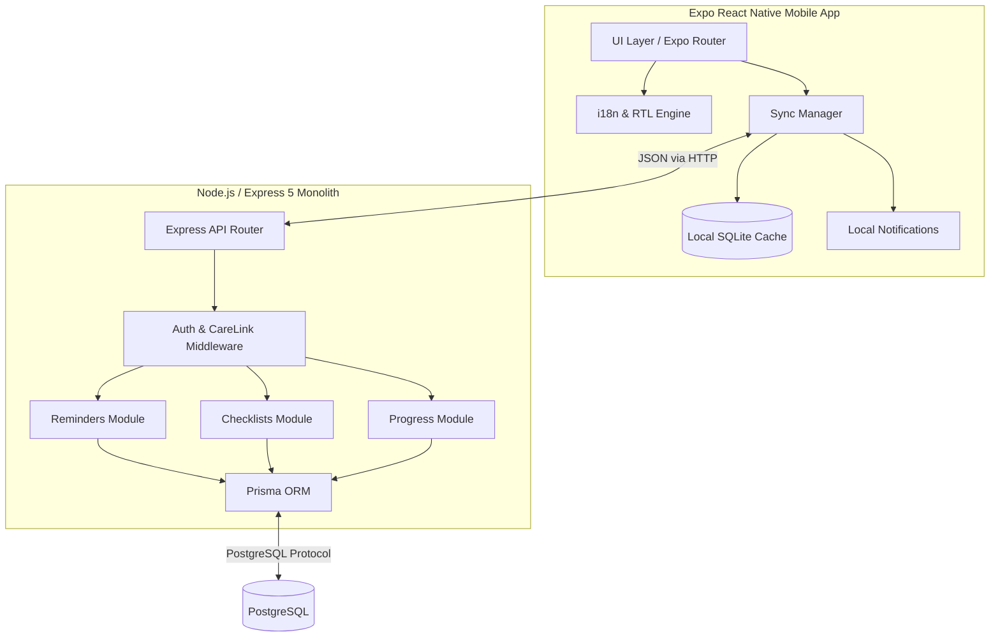

# 03 — Architecture Overview

---

## 1. Locked Intended Design

The Cognitive Support App is designed as a **Modular Monolith Backend** paired with a **Thick-Client Mobile App**. 

The fundamental architectural principle is that the **backend is the authoritative source of truth**, but the mobile client must maintain local resilience to ensure alarms and offline checks remain functional.

### Architectural Diagram

### Core Decisions
1.  **Mobile Framework:** Expo/React Native. Chosen to deploy to both iOS and Android from a single codebase.
2.  **Backend Framework:** Node.js + Express 5 + TypeScript. Chosen for tight ecosystem integration and shared type contracts with the frontend.
3.  **Database ORM:** Prisma. Chosen for type safety and academic defensibility through structured schema management.
4.  **Local vs. Push Notifications:** The system deliberately uses local notification scheduling rather than server-side push notifications to guarantee reminder delivery regardless of network connectivity.

---

## 2. Current Implementation State

The architecture is currently implemented and usable in the present prototype with the following components actively functioning:

*   **Mobile Client:** Runs via Expo Go. Architecture separated into `mobile/src/features/*` and `mobile/src/infrastructure/*`.
*   **Backend Monolith:** Running via `npm run dev`. Structured strictly in `backend/src/modules/*` following the controller/service/repository pattern.
*   **Database:** PostgreSQL schema defined in `backend/prisma/schema.prisma`.
*   **Arabic Support:** The `I18nManager` successfully forces RTL layout at the React Native process level.

---

## 3. Known Limitations / Future Work

While the architecture is stable, there are known gaps between the intended design and the current implementation:

1.  **Sync Completeness:** The intended offline mutation queue (saving changes locally while offline and syncing later) is not implemented. Actions require an active connection.
2.  **Real-Time Push:** The backend has a Socket.IO module intended to push updates to the patient when a caregiver edits a reminder, but the mobile-side subscription is partially implemented. Polling or app-restart is currently required to fetch new definitions.
3.  **Media Hosting:** Media is stored on the local filesystem (`uploads/`) rather than an object store like AWS S3. This requires specific LAN network configurations during testing.

---

*Traceability: Mobile entry points in `mobile/app/`, backend entry point in `backend/src/app/server.ts`, database schema in `backend/prisma/schema.prisma`.*
