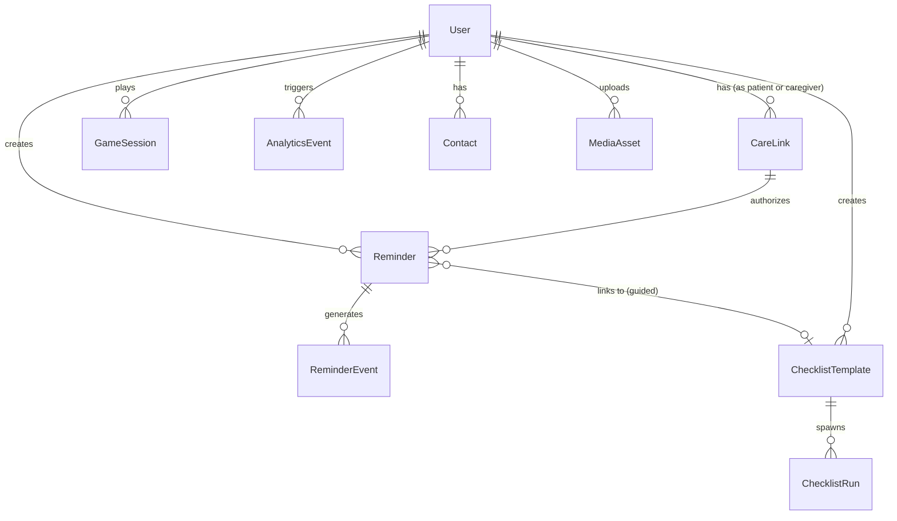

# 06 — Data Model

---

## 1. Locked Intended Design

The database is built on PostgreSQL, managed via Prisma ORM. The model is highly relational and is designed to separate the **definition** of an action from the **historical event** of that action.

### Entity Relationship Diagram

### Core Entities

1.  **User:** Represents both patients and caregivers. Contains role and language preferences.
2.  **CareLink:** The authorization edge between a Caregiver and a Patient, containing permission flags (`canCreateReminders`, `canEditChecklists`, etc.).
3.  **Reminder:** The scheduling definition (Time, Recurrence, Priority, Type).
4.  **ReminderEvent:** An immutable record of an action taken on a Reminder (Done, Snooze, Skip, Start Now).
5.  **ChecklistTemplate:** The definition of a routine and its steps.
6.  **ChecklistRun:** The historical execution record of a template.
7.  **Progress/Analytics:** Stored via `AnalyticsEvent` (for telemetry) and derived on-the-fly from `ReminderEvent` and `ChecklistRun` (for academic evidence).

---

## 2. Current Implementation State

The data model is currently implemented in `backend/prisma/schema.prisma` and is queryable through the Prisma client.

*   **Role Enforcement:** The `Role` enum (PATIENT, CAREGIVER) is strictly enforced in the schema.
*   **Archiving:** Entities like `Reminder` and `ChecklistTemplate` use `isActive: Boolean` and `archivedAt: DateTime` rather than hard deletion, supporting historical data integrity.
*   **Media Relationships:** Entities reference media via `mediaId` string fields, resolving to `MediaAsset` records for contact photos and checklist visual cues.

---

## 3. Known Limitations / Future Work

*   **Missing User Preferences:** The original blueprint specified `timezone`, `accessibilitySettings`, and `lastSeenAt` on the User model. These are omitted in the current schema.
*   **Event Batching Tables:** The system currently ingests `AnalyticsEvent` records directly. A robust implementation would write raw events to a fast-append store before normalizing them to PostgreSQL.
*   **Invite Code Expiry:** `CareLink` currently lacks an `inviteCodeExpiresAt` field, meaning generated codes never expire.

---

*Traceability: Defined exclusively in `backend/prisma/schema.prisma`.*
