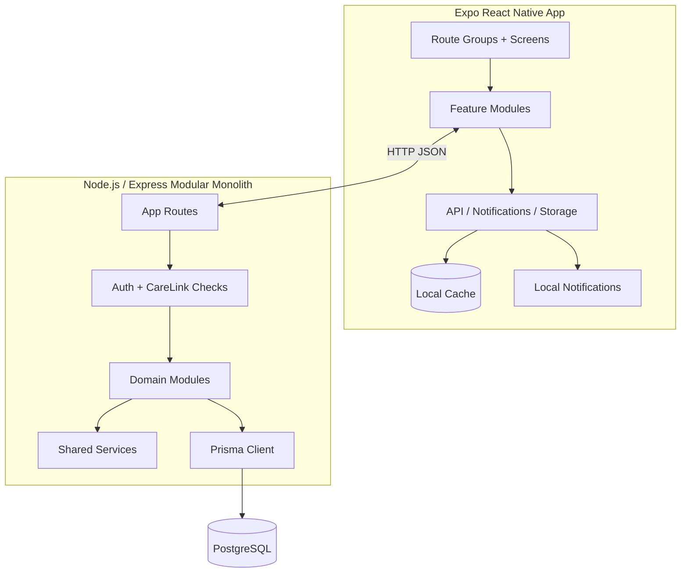

# 03 — Architecture Overview

---

## 1. Locked Intended Design

The Cognitive Support App is designed as a **mobile-first assistive system** with a **custom backend as the authoritative source of truth** and a **locally resilient client**.

At a high level, the intended architecture is:

- **Expo / React Native client** for patient and caregiver experiences
- **Node.js + Express + TypeScript modular monolith backend**
- **PostgreSQL + Prisma** for structured persistence
- **Local device cache and local notification scheduling** to improve resilience and usability
- **Derived progress/evaluation layer** built from reminders, checklist runs, games, and event telemetry rather than from manually maintained summary tables

### High-Level Diagram

### Core Architectural Decisions

1. **Single mobile codebase** — Expo/React Native supports one codebase for iOS and Android while keeping patient and caregiver experiences inside one product.
2. **Custom backend** — a custom API keeps business rules, caregiver access control, and progress derivation centralized.
3. **Backend as source of truth** — role logic, patient scoping, reminders, checklist definitions, and progress aggregation are owned by the backend rather than by local device state.
4. **Local resilience rather than local ownership** — the phone keeps local cache and schedules notifications locally, but this does not make the device the final business source of truth.
5. **Derived progress design** — progress summaries should be recomputed from recorded activity rather than manually edited summary rows.

---

## 2. Current Implementation

The current prototype follows the intended structure in a recognizable way, although some parts are more mature than others.

### Frontend

Current implementation is organized primarily under:

- `mobile/app/` for Expo Router entry points and route groups
- `mobile/src/features/` for domain-specific client logic
- `mobile/src/infrastructure/` for API, notifications, storage, sync, and theme concerns
- `mobile/src/shared/` for reusable UI and utility concerns

### Backend

Current backend implementation is organized primarily under:

- `backend/src/app/` for server/bootstrap/routing entry points
- `backend/src/modules/` for feature/domain modules
- `backend/src/shared/` for shared middleware, config, DB, validation, and utilities
- `backend/prisma/schema.prisma` for the Prisma data model

### What is clearly present in the current codebase

- a modular backend structure rather than a single-file API
- a structured frontend split rather than a single unlayered Expo app
- PostgreSQL/Prisma-backed entity modeling
- notification and local cache concepts in the client architecture
- Arabic/English language support as part of the product model

---

## 3. Traceability to Current Code

This architectural model is reflected in the repository at these locations:

- **Mobile routing:** `mobile/app/`
- **Mobile infrastructure and API access:** `mobile/src/infrastructure/`
- **Mobile feature modules:** `mobile/src/features/`
- **Backend bootstrapping:** `backend/src/app/server.ts`, `backend/src/app/app.ts`, `backend/src/app/routes.ts`
- **Backend modules:** `backend/src/modules/`
- **Shared backend concerns:** `backend/src/shared/`
- **Database schema:** `backend/prisma/schema.prisma`

The architecture documentation should therefore be read as both a design explanation and a map to the current code layout.

---

## 4. Known Gaps / Current Limitations

The architecture is coherent, but some intended behaviors remain partial in the current prototype.

1. **Offline mutation handling is still limited.** Local cache exists, but a full reliable offline queue with later replay is not yet fully realized across all task flows.
2. **Realtime synchronization is not yet the dominant path.** Some flows still depend on refresh, reopen, or periodic synchronization rather than immediate bidirectional update delivery.
3. **Media delivery has been a known development limitation.** Local filesystem storage and localhost-based assumptions have created differences between laptop-browser testing and phone testing.
4. **Deployment/distribution realism is still evolving.** The current architecture is suitable for remote/public deployment, but the prototype environment may still contain local-development assumptions in some paths.

---

## 5. Thesis Use Note

For thesis purposes, this file should be read as the high-level architecture chapter input. More implementation-specific detail is provided in:

- `04_frontend_architecture.md`
- `05_backend_architecture.md`
- `06_data_model.md`
- `12_notifications_sync_and_local_cache.md`
- `13_media_handling_and_delivery.md`
